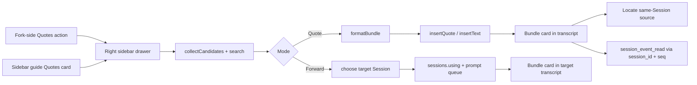

# dsh-better-quotes

[](https://github.com/SpellingDragon/dsh-better-quotes/actions/workflows/ci.yml)
[](LICENSE)

Quote or forward whole messages in DeepSeek Harness Web — from a **Quotes** action next to Fork, through a right-side drawer, with a bounded bundle the model can read and look up.

`dsh-better-quotes` does not open a modal. Click the quote icon between Copy and Fork on an assistant response; the right sidebar opens the Quotes drawer with that message preselected. Select any mix of user and assistant messages, then:

- **Insert quote** — one `<quoted_messages>` bundle enters the composer.
- **Forward** — the same bundle is sent into another local Session.

Every bundle keeps the source Session, event sequence, message identity, sender, time, provider/model route, skills, references, and attachment manifests.

## Features

- **Fork-side entry** — a Quotes action in the assistant action strip, between Copy and Fork, preselecting the message you clicked.
- **Right-sidebar drawer** — multi-select, search, select-all, and a capability switch for Quote vs Forward; no separate modal window.
- **Whole-message selection** — user, steering, and finalized assistant messages in any combination.
- **One bounded bundle** — a single `<quoted_messages>` envelope with an explicit count and per-message tags, instead of N disconnected quotes.
- **Cross-Session forwarding** — choose a target Session from the drawer and send the same bundle; the target renders it as a forwarded quote card.
- **Expandable bundle card** — sent quotes render as a compact card with per-message role, time, attachment count, and a locate control for same-Session sources.
- **Multimodal-aware** — image and file attachments become manifest lines with durable ids, names, sizes, media types, and dimensions. Bytes and pixels are referenced, not copied.
- **Model lookup path** — with the optional `dsh-tool-session-query` bundle, the model can call `session_event_read` with the bundle's `session_id` and `seq`.
- **Public seams only** — Chat snapshot and standard Session props; no DOM scraping and no horizontal plugin imports.
- **Atomic quote or text fallback** — `insertQuote` when the host exposes it, `insertText` at the caret otherwise.
- **Lifecycle-safe** — drawer, action, bundle renderer, locale dictionaries, and stylesheet all leave with the plugin fiber.
- **Local-only** — no external HTTP requests, telemetry, or remote services.

## Quick start

### Build an installable tarball

```sh
npm ci
npm run build
npm pack
```

This produces `dsh-better-quotes-0.2.0.tgz`. `npm pack` runs the build through `prepack`.

### Install into DeepSeek Harness

```sh
dsh plugin --profile web add /absolute/path/to/dsh-better-quotes-0.2.0.tgz
```

From a DSH source checkout:

```sh
pnpm dsh plugin --profile web add /absolute/path/to/dsh-better-quotes-0.2.0.tgz
```

Restart `dsh web` or refresh the browser.

### Install from a registry

The package is prepared for `npm publish --access public`. Once published:

```sh
dsh plugin --profile web add dsh-better-quotes
```

## Usage

### Quote

1. Hover a finalized assistant response and click the quote icon between Copy and Fork. The right-sidebar Quotes drawer opens with that message preselected.
2. Select more messages, search, or use **Select all** for the current filtered list.
3. Keep the mode on **Insert quote** and click **Insert quote (N)**. One bundle enters the composer.
4. Send. The transcript shows a compact quoted-messages card.

You can also open the drawer from the **Quotes** card on the right sidebar guide, which is useful when you want to start from user messages.

### Forward

1. Open the drawer and select messages.
2. Switch the mode to **Forward** and click **Choose target**.
3. Pick a target Session. Subagent Sessions and the current Session are excluded.
4. Click **Send to “…”**. The target receives the bundle as a queued user prompt.
5. The target transcript renders a card labeled **From another session**; source locate is intentionally unavailable across Sessions.

### Locate

In a same-Session bundle card, click **Locate** on an item. The plugin scrolls to the rendered original and briefly highlights it.

## Bundle format

One insert creates one envelope:

```xml
<quoted_messages version="1" source_session="…" count="2">
<quoted_message role="user" time="2026-10-26T04:05:06.789Z" seq="12" message_id="…" session_id="…">
<metadata>
<skill name="pdf" />
<reference name="Spec" />
</metadata>
The deployment failed after the schema change.
[attachment kind=file name="deploy.log" bytes=4096 id="…"]
</quoted_message>
<quoted_message role="assistant" time="2026-10-26T04:05:08.000Z" seq="13" message_id="…" session_id="…">
<metadata provider="deepseek" model="deepseek-chat">
</metadata>
It fails because the migration dropped the index.
</quoted_message>
</quoted_messages>
```

| Field | Meaning |
|---|---|
| `source_session` | Session that owns every message in the bundle |
| `count` | Declared message count; the parser falls back to parsed items |
| `role` | `user` or `assistant` |
| `mode="steering"` | Present when the user message was admitted mid-turn |
| `time` | ISO 8601 timestamp from the original event envelope |
| `seq` | Original event sequence used by `session_event_read` |
| `message_id` | Durable message identity; omitted when the host does not expose one |
| `session_id` | Session that owns the individual message |
| `provider` / `model` | Assistant route from `providerMetadata` |
| `<skill>` / `<reference>` | Skill names and `@session` labels attached to the message |
| `[attachment …]` | Durable image/file manifest; bytes are not copied |

Message text is boundary-neutralized: literal `<quoted_message>` / `<quoted_messages>` tags are escaped so upstream content cannot close the envelope early.

## Multimodal behavior

- User messages contribute text, images, files, skills, and session references.
- Assistant messages contribute text and images plus the provider/model route.
- Reasoning and tool calls are not quoted.
- Attachments are **referenced**, not re-uploaded. The original message remains the source of truth. If history compaction removes it, image pixels may no longer be available; files remain readable only while their saved path is still in history.
- Re-attaching original attachments is a roadmap item.

## Model lookup

Bundles carry `session_id` and `seq`. Mount the experimental session query tools:

```yaml
- name: '@deepseek-ai/dsh-tool-session-query'
```

The model can then call `session_event_read` with the bundle identity. Without that tool, the bundle text and metadata remain readable but cannot be queried by identity.

## Compatibility

| Host behavior | Plugin behavior |
|---|---|
| DSH `>=0.2.1-rc.3 <0.3.0-0` | Supported target; the right Sidebar ships in the Web profile |
| `InputActions.insertQuote` present | One atomic quote node containing the whole bundle |
| `insertQuote` absent | Plain bundle text inserted at the caret via `insertText` |
| User message has `messageId` | Emitted as `message_id` |
| User message lacks `messageId` | Bundle still works; `message_id` is omitted |
| Chat view inactive | Drawer lists no messages; assistant action still registers |
| Source Session differs | Bundle card shows **From another session** and hides locate |

The package has no runtime npm dependencies. The browser bundle requests React, `react/jsx-runtime`, and `@deepseek-ai/dsh-client-ui-primitives` from the DSH module table.

## Privacy and security

- No external HTTP requests, analytics, or remote services.
- No DOM scraping: candidates come from the Chat snapshot already rendered by DSH.
- Cross-Session forwarding stays inside the same local DSH process and only targets Sessions the client already lists.
- Attachment bytes, image pixels, and local filesystem paths are never copied into the bundle.
- Bundle text is ordinary user-message content and therefore logged by the Session like any other prompt.
- React escapes all rendered text; the plugin does not inject HTML.
- CSS class names are prefixed with `bq-` to avoid collisions.

## How it compares

Public READMEs as of **2026-10-26**; check upstream for current behavior.

| Plugin | Entry and selection | Quote shape | Cross-Session forwarding | Metadata / lookup | Multimodal |
|---|---|---|---|---|---|
| **dsh-better-quotes** | Fork-side Quotes action + right drawer; whole messages | One bounded `<quoted_messages>` bundle | Yes, from the same drawer | `session_id`, `seq`, `message_id`, time, role, route, skills, references | Image/file manifests |
| [dsh-message-forward](https://github.com/Domaki-co/dsh-message-forward) | Long-press multi-select; forward dialog | Forwarding context | Yes | Source session and speaker | Text and images |
| [dsh-quote-followup](https://github.com/tr1v3r/dsh-quote-followup) | Selection toolbar; text | Quote chips / follow-up | No | Text selection | Text |
| [dsh-select-quote](https://github.com/latte03/dsh-select-quote) | Floating selection toolbar; text | Stacked quote cards | No | Text selection | Text |
| [dsh-quote-annotate-pro](https://github.com/zhao-guang-ai/dsh-quote-annotate-pro) | Selection toolbar; text + annotation | Compact anchored quote blocks | No | Turn/role anchors | Text |
| [dsh-multi-selection-comments](https://github.com/yuanc1204/dsh-multi-selection-comments) | Selection toolbar; multiple text segments | Structured context injection | No | Segments and comments | Text |

What this plugin borrows from the ecosystem:

- From **dsh-message-forward**: whole-message multi-select and cross-Session delivery.
- From **dsh-quote-annotate-pro**: compact quote presentation and source anchoring.
- From **dsh-select-quote**: independently removable quote entries and marker stripping.
- From **dsh-multi-selection-comments**: structured context injection instead of ad-hoc text concatenation.
- From **dsh-quote-followup**: public seams only, with a Web-only scope stated up front.

Where it deliberately differs:

- **Drawer, not modal.** The Fork-side action opens the existing right Sidebar; selection no longer interrupts the conversation with a centered dialog.
- **One bundle, not N quotes.** A single envelope carries source, count, order, and per-message boundaries, so the model sees one context block.
- **Durable provenance.** The bundle can be looked up by `session_id` + `seq`; most selection-quote plugins only keep the text.
- **Bundle card in the transcript.** Sent bundles render as an expandable card with per-message locate, instead of a raw quote block.

## Design notes

- **Fork-side entry.** The assistant action strip already owns Copy and Fork; the quote action sits between them with the same 24px icon treatment. Clicking it opens `ctx.sidebarRight.openTab('better-quotes', { params: { select: messageId } })`.
- **Drawer body is a normal sidebar tab.** It registers a tab type and a keyed body through `ctx.sidebarRightTabs` and `sidebar.right.pane.tab`, so the existing sidebar owns width, docking, and fullscreen behavior.
- **No DOM scraping.** `collectCandidates` reads visible `user`, `steering`, and `assistant-step` nodes from the Chat snapshot. Locate uses the rendered `data-chat-node-key` only for scrolling.
- **One bundle per action.** Selection order is normalized to log order; each message remains independently visible inside the envelope.
- **Forwarding uses the same serializer.** The target receives `formatForwardPrompt(bundle)`, which adds a non-instruction preamble; the bundle card in the target knows the source is another Session.
- **Attachment manifests, not copies.** The durable attachment id is the link back to the original; the plugin never reads file bytes or image pixels.
- **Compatibility fallback.** Current hosts expose `insertQuote`; older hosts keep `insertText` + `captureInsertion`.



## Limitations and roadmap

- The picker lives in the right drawer; it does not inject inline checkboxes into every message row.
- Locate works only inside the source Session. Forwarded bundle cards intentionally hide cross-Session locate.
- Attachments are referenced, not re-attached. Image/file re-attachment and thumbnails are planned.
- Only the loaded, visible Chat window is listed; very long histories are bounded by DSH's loaded window.
- Model lookup requires the optional `dsh-tool-session-query` bundle.
- No browser E2E or GIF yet; current tests cover bundle round-trip, rule parsing, candidate projection, drawer quoting/forwarding, fallback insertion, and registration lifecycle.

## Development

```sh
npm ci
npm run typecheck
npm test
npm run build
npm pack
```

- `src/client/QuoteDrawer.tsx` — sidebar drawer, search, quote/forward modes, target picker.
- `src/client/QuoteRow.tsx` — selectable message row.
- `src/client/QuoteAction.tsx` — Fork-side assistant action.
- `src/client/bundle.ts` — bundle serialization and parsing.
- `src/client/quote-rule.ts` — UserText rule for raw and blockquoted bundles.
- `src/client/BundleQuote.tsx` — sent bundle card and locate.
- `src/client/candidates.ts` — Chat snapshot projection.
- `src/client/styles.ts` — plugin stylesheet with a disposer.
- `tests/` — 29 focused tests across bundle, rule, projection, drawer, bundle card, action registration, and lifecycle.

## License

MIT. See [LICENSE](LICENSE).

中文说明见 [README.zh.md](README.zh.md)。
