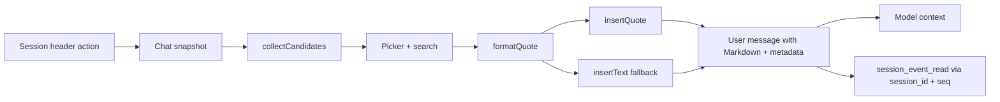

# dsh-better-quotes

[](https://github.com/SpellingDragon/dsh-better-quotes/actions/workflows/ci.yml)
[](LICENSE)

Multi-select message quoting for DeepSeek Harness Web, with durable metadata the model can read and look up.

Most DSH quote plugins quote a text selection. **dsh-better-quotes** quotes whole messages — any mix of user and assistant — and keeps the original sender, time, message identity, provider route, skills, references, and attachment manifests in a compact metadata tail.

```markdown
> The deployment failed after the schema change.
>
> [attachment kind=file name="deploy.log" bytes=4096 id="…"]
>
> [multiquote role=assistant speaker=assistant provider="deepseek" model="deepseek-chat" time=2026-10-26T04:05:06.789Z seq=42 message_id="…" session_id="…"]
```

## Features

- **Whole-message multi-select** — select any combination of user, steering, and finalized assistant messages, not just a text span.
- **Search inside the picker** — filter by message text, role, provider/model, skill, session reference, or attachment name.
- **Durable metadata** — `session_id`, `seq`, `message_id`, `role`, `speaker`, ISO time, provider/model, skills, and references.
- **Multimodal-aware** — image and file attachments become `[attachment …]` manifests with durable ids, names, sizes, media types, and dimensions. Bytes and pixels are referenced, not copied.
- **Model lookup path** — with the optional `dsh-tool-session-query` bundle mounted, the model can call `session_event_read` with the quoted `session_id` and `seq`.
- **Locate the original** — jump back to the rendered message and briefly highlight it.
- **Public seams only** — reads the Chat snapshot through standard Session props; no DOM injection and no horizontal plugin imports.
- **Atomic quote, graceful fallback** — uses `insertQuote` when the host exposes it; older hosts fall back to `insertText` at the caret.
- **Lifecycle-safe** — the header action, locale dictionaries, and injected stylesheet are all removed with the plugin fiber.
- **Local-only** — no network requests, no telemetry, no external service.

## Quick start

### Build an installable tarball

```sh
npm ci
npm run build
npm pack
```

This produces `dsh-better-quotes-0.1.0.tgz`. `npm pack` runs the build automatically through `prepack`.

### Install into DeepSeek Harness

```sh
dsh plugin --profile web add /absolute/path/to/dsh-better-quotes-0.1.0.tgz
```

If you run DSH from a source checkout:

```sh
pnpm dsh plugin --profile web add /absolute/path/to/dsh-better-quotes-0.1.0.tgz
```

Restart `dsh web` or refresh the browser. The Session header shows **Quote messages**.

### Install from a registry

The package is prepared for `npm publish --access public`. Once published, the install command becomes:

```sh
dsh plugin --profile web add dsh-better-quotes
```

## Usage

1. Open a Session and click **Quote messages** in the header.
2. Search or scroll, then select any user or assistant messages.
3. Use **Select all** / **Clear** for the currently visible (filtered) list.
4. Click **Insert quotes**. Messages enter the composer in original log order, each as an atomic quote when the host supports it.
5. Use the locate button on a row to scroll back to the original message.

The header entry is disabled when the Chat view is inactive. Only visible, finalized Chat nodes are listed; collapsed process rows and running assistant messages are excluded.

## Metadata

Each quote ends with one machine-readable line:

```text
[multiquote role=… speaker=… provider=… model=… time=… seq=… message_id=… session_id=… skills=[…] references=[…]]
```

| Field | Meaning |
|---|---|
| `role` | `user` or `assistant` |
| `speaker` | Sender label; currently mirrors `role` |
| `mode=steering` | Present when the user message was admitted mid-turn |
| `provider` / `model` | Assistant route from `providerMetadata` |
| `time` | ISO 8601 timestamp from the original event envelope |
| `seq` | Original event sequence used by `session_event_read` |
| `message_id` | Durable message identity; omitted when the host does not expose one |
| `session_id` | Session that owns the original event |
| `skills` | Skill names loaded for that user message |
| `references` | `@session` reference labels attached to that message |

Attachments use a separate line so the model can identify them without copying bytes:

```text
[attachment kind=image name="chart.png" media_type="image/png" bytes=245760 width=1280 height=720 id="…"]
[attachment kind=file name="deploy.log" bytes=4096 id="…"]
```

## Multimodal behavior

- User messages contribute text, images, files, skills, and session references.
- Assistant messages contribute text and images plus the provider/model route.
- Reasoning and tool calls are not quoted.
- Attachments are **referenced**, not re-uploaded. The original message remains the source of truth. If history compaction removes it, image pixels may no longer be available; files remain readable only while their saved path is still in history.
- Re-attaching original attachments is a roadmap item.

## Model lookup

Quotes carry `session_id` and `seq`. Mount the experimental session query tools:

```yaml
- name: '@deepseek-ai/dsh-tool-session-query'
```

Then the model can call `session_event_read` with the quoted identity. Without that tool, the quote text and metadata remain readable but cannot be queried by identity.

## Compatibility

| Host behavior | Plugin behavior |
|---|---|
| DSH `>=0.2.1-rc.3 <0.3.0-0` | Supported target |
| `InputActions.insertQuote` present | Atomic quote node in the composer |
| `insertQuote` absent | Plain Markdown quote inserted at the caret via `insertText` |
| User message has `messageId` | Emitted as `message_id` |
| User message lacks `messageId` | Quote still works; `message_id` is omitted |
| Chat view inactive | Header entry disabled |

The package has no runtime npm dependencies. The browser bundle requests React, `react/jsx-runtime`, and `@deepseek-ai/dsh-client-ui-primitives` from the DSH module table.

## Privacy and security

- No external HTTP requests, analytics, or remote services.
- No DOM scraping: candidates come from the Chat snapshot already rendered by DSH.
- Attachment bytes, image pixels, and local filesystem paths are never copied into the quote.
- Quote text is ordinary user-message content and therefore logged by the Session like any other prompt.
- React escapes all rendered text; the plugin does not inject HTML.
- CSS class names are prefixed with `bq-` to avoid collisions.

## How it compares

The DSH plugin ecosystem is moving quickly. This table summarizes public READMEs as of **2026-10-26**; check upstream for current behavior.

| Plugin | Selection granularity | Durable per-message metadata | Multimodal facts | Entry point |
|---|---|---|---|---|
| **dsh-better-quotes** | Whole user/assistant messages, arbitrary subset | `session_id`, `seq`, `message_id`, time, role, route, skills, references | Image/file manifests | Header dialog + search |
| [dsh-message-forward](https://github.com/Domaki-co/dsh-message-forward) | Single or multi-selected whole messages | Source session and speaker; forwarding context | Text and images | Long-press multi-select, forward dialog |
| [dsh-quote-followup](https://github.com/tr1v3r/dsh-quote-followup) | Selected text excerpts | Text selection; follow-up oriented | Text | Selection toolbar / chips |
| [dsh-select-quote](https://github.com/latte03/dsh-select-quote) | Selected text | Text selection; stacked cards | Text | Floating selection toolbar |
| [dsh-quote-annotate-pro](https://github.com/zhao-guang-ai/dsh-quote-annotate-pro) | Selected text with annotations | Turn/role anchors and compact quote blocks | Text | Selection toolbar |
| [dsh-multi-selection-comments](https://github.com/yuanc1204/dsh-multi-selection-comments) | Multiple independent text segments | Structured context injection | Text | Selection toolbar |

What this plugin borrows from the ecosystem:

- From **dsh-message-forward**: explicit compatibility and security boundaries, and whole-message multi-select as a first-class flow.
- From **dsh-quote-annotate-pro**: compact quote presentation and source anchoring.
- From **dsh-select-quote**: stacked, independently removable quote entries and marker stripping at send time.
- From **dsh-multi-selection-comments**: structured context injection instead of ad-hoc text concatenation.
- From **dsh-quote-followup**: public seams only, with a Web-only scope stated up front.

Where it deliberately differs:

- **Panel instead of inline checkboxes.** DSH has no official user-message action slot today. A header dialog over the Chat snapshot avoids the DOM-contract maintenance that inline injection requires.
- **Message-level, not text-level.** The quote captures the whole message and its attachments; users can still quote a subset by selecting a message rather than a span.
- **Metadata tail instead of hidden state.** The quote is plain Markdown that survives copy, resend, and log replay. There is no companion browser-side store to lose.

## Design notes

- **No DOM scraping.** `collectCandidates` reads visible `user`, `steering`, and `assistant-step` nodes from the Chat snapshot. Locate uses the rendered `data-chat-node-key` only for scrolling.
- **Metadata at the end.** The original text comes first so the official quote preview starts with meaningful content; identity stays in one compact tail.
- **One quote per message.** Selection order is normalized to log order; each message remains independently removable.
- **Attachment manifests, not copies.** The durable attachment id is the link back to the original; the plugin never reads file bytes or image pixels.
- **Compatibility fallback.** The current source host exposes `insertQuote`; older hosts keep `insertText` + `captureInsertion`, so the plugin does not hard-depend on a newer input API.
- **Filtered select-all.** **Select all** selects the currently filtered list, not hidden rows.



## Limitations and roadmap

- The picker is a header dialog; it does not inject inline checkboxes into message rows.
- Sent quote previews use the official quote presentation; click-to-jump from a sent quote is not implemented (locate is available in the picker).
- Attachments are referenced, not re-attached. Image/file re-attachment and thumbnails are planned.
- Only the loaded, visible Chat window is listed; very long histories are bounded by DSH's loaded window.
- Model lookup requires the optional `dsh-tool-session-query` bundle.
- No browser E2E or GIF yet; current tests cover candidate projection, formatting, picker interaction, fallback insertion, and registration lifecycle.

## Development

```sh
npm ci
npm run typecheck
npm test
npm run build
npm pack
```

- `src/client/candidates.ts` — Chat snapshot to quote candidates.
- `src/client/format.ts` — Markdown and metadata serialization.
- `src/client/MessageMultiquote.tsx` — picker, search, selection, locate.
- `src/client/styles.ts` — plugin-owned stylesheet with a disposer.
- `tests/` — 23 focused tests across formatting, projection, picker behavior, fallback insertion, and lifecycle.

## License

MIT. See [LICENSE](LICENSE).

中文说明见 [README.zh.md](README.zh.md)。
