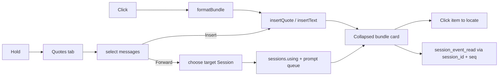

# dsh-better-quotes

[](https://www.npmjs.com/package/dsh-better-quotes)
[](https://github.com/SpellingDragon/dsh-better-quotes/actions/workflows/ci.yml)
[](LICENSE)

<p align="center">
  
</p>

**Quote or forward whole messages in DeepSeek Harness Web — one click, one bundle, every identity the model needs.**

Select-to-quote copies text fragments that forget where they came from. This plugin quotes the *whole message* — user, steering, or assistant — together with its sender, time, identity, model route, skills, references, and attachments, wrapped in one bounded bundle the model can read and look up again.

## Features

- **One control, two outcomes.** Click the quote icon between Copy and Fork to quote that message immediately; hold it (or press `Shift+Enter`) to open multi-select. The transcript gains no extra checkboxes or toolbars.
- **Whole-message multi-select.** Pick any user, steering, and finalized assistant messages from the right-Sidebar **Quotes** tab. The transcript never scrolls, blanks, or gets covered while you choose.
- **Durable metadata.** Every quoted message carries sender role, time, `session_id`, `seq`, `message_id`, provider/model, loaded skills, `@session` references, and image/file attachments with names, sizes, and dimensions.
- **One bounded bundle.** A single `<quoted_messages>` envelope replaces N disconnected blockquotes — the model reads the quote as context and can query the original events by identity.
- **Cross-session forwarding.** Send the same bundle to any other local Session as non-instruction reference context, from the same panel.
- **Click to locate.** Sent bundle cards start folded; clicking an item scrolls to the source and highlights it, unfolding collapsed process groups first. Cards from other sessions say so and hide navigation.
- **A quote chip that reads like a label.** The composer shows a one-line summary (count and message previews) instead of raw envelope tags.
- **Local-first.** No external requests, no analytics, no remote services — everything runs inside your DSH process.

## Quick start

```sh
npm ci
npm run build
npm pack
dsh plugin --profile web add /absolute/path/to/dsh-better-quotes-0.5.0.tgz
```

From a DSH source checkout, use `pnpm dsh plugin` instead of `dsh plugin`. Restart `dsh web` or refresh the browser. The package targets DSH `>=0.2.1-rc.3 <0.3.0-0`.

Once published to npm:

```sh
dsh plugin --profile web add dsh-better-quotes
```

## How it works

### Quote one message

Click the icon between Copy and Fork. The message enters the composer immediately, matching the official select-to-quote interaction. The quote chip shows a one-line summary — quoted count and message previews — and carries the bundle inside the same quote.

### Quote or forward several

1. Hold the same icon for half a second, or press `Shift+Enter`.
2. The Quotes tab opens in the right Sidebar with that message selected, its list starting at the newest messages. Click rows to toggle selection, search to narrow the list, and use the single all/none control for what is shown.
3. Choose **Insert quote (N)** to place one bundle in the composer, or **Forward** to pick another local Session and send the same bundle. Either action collapses the Sidebar when it completes.
4. The target excludes the current Session and subagent Sessions.

### Locate

Sent bundle cards start folded. Expand one and click a same-Session item to scroll to the rendered original and briefly highlight it. Folded process groups are expanded first. Forwarded cards show **From another session** and hide source navigation.

## Bundle format

One insert creates one envelope; the composer draft prefixes the summary line its quote chip shows, and once sent the card owns that line so the transcript shows only the card:

```xml
<quoted_messages version="1" source_session="…" count="2">
<quoted_message role="user" time="2026-10-26T04:05:06.789Z" seq="12" message_id="…" session_id="…">
<metadata>
<skill name="pdf" />
<reference name="Spec" />
</metadata>
The deployment failed after the schema change.
[attachment kind=file name="deploy.log" bytes=4096 id="…"]
</quoted_message>
<quoted_message role="assistant" time="2026-10-26T04:05:08.000Z" seq="13" message_id="…" session_id="…">
<metadata provider="deepseek" model="deepseek-chat">
</metadata>
It fails because the migration dropped the index.
</quoted_message>
</quoted_messages>
```

`session_id` + `seq` let the model read the original event with `session_event_read`; `message_id` is omitted when the host does not expose one. `<skill>` and `<reference>` record loaded skills and `@session` labels. `[attachment …]` records durable image/file ids, names, sizes, media types, and dimensions. Literal boundary tags in message text are escaped.

Attachments are referenced, not copied. If history compaction removes the original, image pixels may be unavailable; files remain readable only while their saved path is in history.

## Model lookup

Mount the optional session query tools when the model should read source events:

```yaml
- name: '@deepseek-ai/dsh-tool-session-query'
```

The bundle remains readable without it, but cannot be queried by identity.

## Compatibility and privacy

- `insertQuote` is used when the host exposes it; older hosts fall back to `insertText` at the caret.
- The selector reads the Chat snapshot through standard Session props; it does not scrape the DOM.
- Forwarding stays inside the local DSH process and only targets Sessions the client lists.
- No external HTTP requests, analytics, or remote services.
- All text is React-rendered; stylesheet classes are prefixed `bq-`.

## How it compares

Public READMEs as of **2026-10-26**.

| Plugin | Selection entry | Quote shape | Cross-Session forwarding | Durable identity |
|---|---|---|---|---|
| **dsh-better-quotes** | One action: click quotes, hold multi-selects in the right Sidebar | One bounded `<quoted_messages>` bundle | Yes, same tab | `session_id`, `seq`, `message_id`, time, route, skills, references |
| [dsh-message-forward](https://github.com/Domaki-co/dsh-message-forward) | Long-press multi-select; forward dialog | Forwarding context | Yes | Source session and speaker |
| [dsh-quote-followup](https://github.com/tr1v3r/dsh-quote-followup) | Selection toolbar; text | Quote chips | No | Text selection |
| [dsh-select-quote](https://github.com/latte03/dsh-select-quote) | Selection toolbar; text | Stacked cards | No | Text selection |
| [dsh-quote-annotate-pro](https://github.com/zhao-guang-ai/dsh-quote-annotate-pro) | Selection toolbar; text and annotations | Anchored quote blocks | No | Turn/role anchors |
| [dsh-multi-selection-comments](https://github.com/yuanc1204/dsh-multi-selection-comments) | Selection toolbar; multiple text segments | Structured context | No | Segments and comments |

## Design

- One control carries two outcomes: click quotes immediately; hold opens multi-select.
- Multi-select is a `sidebar.right.pane.tab` body, so the transcript stays put while selecting.
- The panel is one transaction: an action collapses the Sidebar, and re-entering starts the list at the newest messages.
- One bundle replaces N disconnected quotes and carries source, count, order, and per-message boundaries.
- Bundle cards start folded; clicking an item is the locate affordance.
- Locate unfolds a folded process group and drives the real vertical scrollport.



## Limitations and roadmap

- Multi-select lives in the right Sidebar, not as per-row checkboxes in the transcript.
- Locate only works inside the source Session.
- Attachments are referenced, not re-attached; thumbnails and re-attachment remain future work.
- Only the loaded, visible Chat window is listed.
- No browser E2E or GIF yet.

## Development

```sh
npm ci
npm run typecheck
npm test
npm run build
npm pack
```

- `QuoteAction.tsx` — click quote / hold multi-select.
- `QuoteDrawer.tsx` and `QuoteRow.tsx` — right-Sidebar selector and message rows.
- `bundle.ts`, `quote-rule.ts`, `BundleQuote.tsx` — bundle format, parsing, and card.
- `locate.ts` — unfold and source locate.
- `tests/` — 41 focused tests.

## License

MIT. See [LICENSE](LICENSE).

中文说明见 [README.zh.md](README.zh.md)。
