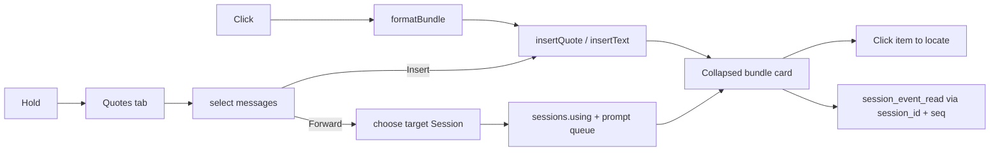

# dsh-better-quotes

[](https://www.npmjs.com/package/dsh-better-quotes)
[](https://github.com/SpellingDragon/dsh-better-quotes/actions/workflows/ci.yml)
[](LICENSE)

<p align="center">
  
</p>

**在 DeepSeek Harness Web 中引用或转发整条消息——一次点击，一个 bundle，模型回查所需的全部身份。**

官方划词引用只复制文本片段，转头就忘了它从哪来。本插件引用**整条消息**——用户、插话或助手——连同发送人、时间、身份、模型路由、Skill、引用和附件，打成一个模型可读、可回查的有界 bundle。

## 特点

- **一个控件，两种结果。** 点击 Copy 与 Fork 之间的引用图标立即引用该消息；长按（或按 `Shift+Enter`）进入多选。会话区不增加任何复选框或工具条。
- **整条消息多选。** 在右侧边栏「引用」标签页里自由多选用户、插话和已完成的助手消息；选择过程中对话区不动、不白屏、不被遮挡。
- **持久元数据。** 每条被引用的消息都带发送人角色、时间、`session_id`、`seq`、`message_id`、provider/model、已加载 Skill、`@session` 引用，以及含名称、大小和尺寸的图片/文件附件。
- **一个有界 bundle。** 单个 `<quoted_messages>` 信封替代 N 条散落的引用块——模型把引用当上下文读，并能按身份回查原事件。
- **跨会话转发。** 从同一个面板把同一个 bundle 作为非指令参考上下文发给任意本地 Session。
- **点击定位。** 发送后的引用卡默认折叠；点击条目滚动到原消息并短暂高亮，折叠的过程组会先展开。跨会话的卡会注明并隐藏来源导航。
- **读得懂的引用芯片。** 输入框里显示一行摘要（引用条数与消息预览），而不是生硬的信封标签。
- **本地优先。** 无外部请求、无遥测、无远程服务——一切都在你的 DSH 进程内运行。

## 快速开始

```sh
npm ci
npm run build
npm pack
dsh plugin --profile web add /absolute/path/to/dsh-better-quotes-0.5.0.tgz
```

从 DSH 源码仓库运行时把 `dsh plugin` 换成 `pnpm dsh plugin`。重启 `dsh web` 或刷新浏览器。支持 DSH `>=0.2.1-rc.3 <0.3.0-0`。

发布到 npm 后可直接：

```sh
dsh plugin --profile web add dsh-better-quotes
```

## 使用

### 单条引用

点击 Copy 与 Fork 之间的引用图标，消息立即进入输入框，交互与官方划词引用一致。引用芯片显示一行摘要（引用条数与消息预览），bundle 附在同一个引用里。

### 多条引用或转发

1. 长按同一个图标约半秒，或按 `Shift+Enter`。
2. 右侧边栏打开「引用」标签页，并已预选该消息，列表停在最新消息。点击行切换选择，搜索缩小列表，单个全选/清空控件操作当前可见结果。
3. 点击 **插入引用（N）** 得到一个 bundle，或点击 **转发** 选择另一个本地 Session 并发送同一个 bundle；任一动作完成后侧边栏自动收起。
4. 目标列表不包含当前 Session 和 subagent Session。

### 定位

发送后的引用卡默认折叠。展开后点击同会话条目，会滚动到原消息并短暂高亮；折叠的过程组会先展开。转发卡显示 **来自其他会话**，不提供来源导航。

## Bundle 格式

一次插入生成一个信封；输入框草稿在其前加上引用芯片显示的摘要行，发送后该行并入引用卡，会话里只显示卡：

```xml
<quoted_messages version="1" source_session="…" count="2">
<quoted_message role="user" time="2026-10-26T04:05:06.789Z" seq="12" message_id="…" session_id="…">
<metadata>
<skill name="pdf" />
<reference name="Spec" />
</metadata>
The deployment failed after the schema change.
[attachment kind=file name="deploy.log" bytes=4096 id="…"]
</quoted_message>
<quoted_message role="assistant" time="2026-10-26T04:05:08.000Z" seq="13" message_id="…" session_id="…">
<metadata provider="deepseek" model="deepseek-chat">
</metadata>
It fails because the migration dropped the index.
</quoted_message>
</quoted_messages>
```

`session_id` + `seq` 让模型用 `session_event_read` 读取原事件；宿主没有 `message_id` 时该字段省略。`<skill>` / `<reference>` 记录已加载 Skill 和 `@session` 标签；`[attachment …]` 记录图片/文件的持久 id、名称、大小、媒体类型和尺寸。正文中的字面边界标签会被转义。

附件只引用、不复制。历史压缩移除原消息后，图片像素可能不可用；文件也只有在原始保存路径仍存在时可读。

## 模型回查

需要模型读取原事件时挂载可选工具：

```yaml
- name: '@deepseek-ai/dsh-tool-session-query'
```

未挂载时 bundle 仍可读，但不能按身份查询原事件。

## 兼容性与隐私

- 宿主提供 `insertQuote` 时使用原子引用；旧宿主回退到光标处 `insertText`。
- 选择器通过标准 Session props 读取 Chat 快照，不抓取 DOM。
- 转发只在同一本地 DSH 进程内、发送到客户端已列出的 Session。
- 无外部 HTTP 请求、遥测或远程服务。
- 所有文本由 React 渲染；样式类名统一加 `bq-` 前缀。

## 与热门插件对比

基于 **2026-10-26** 的公开 README。

| 插件 | 选择入口 | 引用形态 | 跨会话转发 | 持久身份 |
|---|---|---|---|---|
| **dsh-better-quotes** | 一个动作：点击引用，长按右侧边栏多选 | 单个 `<quoted_messages>` bundle | 是，同一标签页 | `session_id`、`seq`、`message_id`、时间、路由、Skill、引用 |
| [dsh-message-forward](https://github.com/Domaki-co/dsh-message-forward) | 长按多选；转发弹窗 | 转发上下文 | 是 | 来源会话与说话者 |
| [dsh-quote-followup](https://github.com/tr1v3r/dsh-quote-followup) | 划词工具条；文本 | 引用 chip | 否 | 文本选择 |
| [dsh-select-quote](https://github.com/latte03/dsh-select-quote) | 划词工具条；文本 | 堆叠卡片 | 否 | 文本选择 |
| [dsh-quote-annotate-pro](https://github.com/zhao-guang-ai/dsh-quote-annotate-pro) | 划词工具条；文本与批注 | 锚点引用块 | 否 | 轮次/角色锚点 |
| [dsh-multi-selection-comments](https://github.com/yuanc1204/dsh-multi-selection-comments) | 划词工具条；多个文本片段 | 结构化上下文 | 否 | 片段与评论 |

## 设计

- 一个控件承载两种结果：点击直接引用，长按进入多选。
- 多选是 `sidebar.right.pane.tab` 标签页正文，选择消息时对话区保持不动。
- 面板是一次事务：动作完成后收起侧边栏，再次进入列表停在最新消息。
- 一个 bundle 替代 N 个散 quote，带来源、数量、顺序和逐条边界。
- 引用卡默认折叠，点击条目即定位。
- 定位会先展开折叠的过程组，再驱动真实滚动容器。



## 限制与后续计划

- 多选在右侧边栏，不向每条消息行注入复选框。
- 定位只在来源 Session 内可用。
- 附件只引用、不重新附加；缩略图和重新附加仍是后续工作。
- 只列出当前已加载、可见的 Chat 窗口。
- 暂无浏览器 E2E 或 GIF。

## 开发

```sh
npm ci
npm run typecheck
npm test
npm run build
npm pack
```

- `QuoteAction.tsx` — 单击引用 / 长按多选。
- `QuoteDrawer.tsx`、`QuoteRow.tsx` — 右侧边栏选择器与消息行。
- `bundle.ts`、`quote-rule.ts`、`BundleQuote.tsx` — bundle 格式、解析与引用卡。
- `locate.ts` — 展开与来源定位。
- `tests/` — 41 个聚焦测试。

## 许可证

MIT。见 [LICENSE](LICENSE)。

English documentation: [README.md](README.md)。
