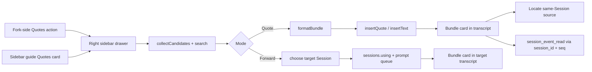

# dsh-better-quotes

[](https://github.com/SpellingDragon/dsh-better-quotes/actions/workflows/ci.yml)
[](LICENSE)

在 DeepSeek Harness Web 中引用或转发整条消息：入口在 Fork 旁边的 **Quotes** 按钮，选择在右侧抽屉完成，发送后得到一个带边界的 bundle，模型可读、可回查。

`dsh-better-quotes` 不再弹独立窗口。把鼠标移到助手回复上，点击 Copy 和 Fork 之间的引用图标，右侧栏会打开 Quotes 抽屉并预选这条消息。随后可任意选择用户和助手消息：

- **插入引用** — 一个 `<quoted_messages>` bundle 进入输入框。
- **转发** — 同一个 bundle 发送到另一个本地 Session。

每个 bundle 都保留来源 Session、事件序号、消息身份、发送人、时间、provider/model 路由、Skill、引用来源和附件清单。

## 功能

- **Fork 旁入口** — 助手动作条中 Copy 与 Fork 之间新增 Quotes 图标，点击即预选当前消息。
- **右侧抽屉** — 多选、搜索、全选，以及 Quote / Forward 能力切换；不占用独立模态窗口。
- **整条消息选择** — 用户、插话、已定稿助手消息可任意组合。
- **单个有边界 bundle** — 一个 `<quoted_messages>` 信封，显式记录数量与逐条边界，而不是 N 个散 quote。
- **跨会话转发** — 抽屉里选择目标 Session，把同一个 bundle 发送过去；目标会话显示为转发的引用卡。
- **可展开引用卡** — 已发送引用显示为紧凑卡片，含逐条角色、时间、附件数量和同会话定位按钮。
- **多模态感知** — 图片/文件转为附件清单，记录持久 id、名称、大小、媒体类型和尺寸；不复制字节和像素。
- **模型回查路径** — 挂载可选的 `dsh-tool-session-query` 后，模型可用 bundle 里的 `session_id` 与 `seq` 调 `session_event_read`。
- **只用公开扩展点** — 基于 Chat 快照和标准 Session props，不做 DOM 抓取，不横向导入其他插件。
- **原子引用与回退** — 宿主有 `insertQuote` 时使用原子引用，否则在光标处 `insertText`。
- **生命周期安全** — 抽屉、动作、引用卡、语言字典和样式都随插件 fiber 移除。
- **纯本地** — 无外部 HTTP 请求、遥测或远程服务。

## 快速开始

### 构建可安装 tarball

```sh
npm ci
npm run build
npm pack
```

生成 `dsh-better-quotes-0.2.0.tgz`。`npm pack` 会通过 `prepack` 自动构建。

### 安装到 DeepSeek Harness

```sh
dsh plugin --profile web add /absolute/path/to/dsh-better-quotes-0.2.0.tgz
```

从 DSH 源码仓库运行：

```sh
pnpm dsh plugin --profile web add /absolute/path/to/dsh-better-quotes-0.2.0.tgz
```

重启 `dsh web` 或刷新浏览器。

### 从 npm registry 安装

包已配置为 `npm publish --access public`。发布后：

```sh
dsh plugin --profile web add dsh-better-quotes
```

## 使用

### 引用

1. 悬停在已定稿的助手回复上，点击 Copy 与 Fork 之间的引用图标。右侧 Quotes 抽屉打开并预选该消息。
2. 继续勾选其他消息，或搜索、使用 **全选** 操作当前过滤结果。
3. 保持 **插入引用** 模式，点击 **插入引用（N）**。一个 bundle 进入输入框。
4. 发送后，会话中显示紧凑的“引用 N 条消息”卡片。

也可以从右侧栏引导页的 **引用** 卡片打开抽屉，适合从用户消息开始选择。

### 转发

1. 打开抽屉并选择消息。
2. 切换到 **转发到会话**，点击 **选择目标会话**。
3. 选择目标 Session；当前 Session 和 subagent Session 会被排除。
4. 点击 **发送到「…」**。目标会话以排队用户消息接收 bundle。
5. 目标会话中显示 **来自其他会话** 的引用卡；跨会话不提供来源定位。

### 定位

同一 Session 的引用卡中，点击某条消息的 **定位**，会滚动到原消息并短暂高亮。

## Bundle 格式

一次插入生成一个信封：

```xml
<quoted_messages version="1" source_session="…" count="2">
<quoted_message role="user" time="2026-10-26T04:05:06.789Z" seq="12" message_id="…" session_id="…">
<metadata>
<skill name="pdf" />
<reference name="Spec" />
</metadata>
The deployment failed after the schema change.
[attachment kind=file name="deploy.log" bytes=4096 id="…"]
</quoted_message>
<quoted_message role="assistant" time="2026-10-26T04:05:08.000Z" seq="13" message_id="…" session_id="…">
<metadata provider="deepseek" model="deepseek-chat">
</metadata>
It fails because the migration dropped the index.
</quoted_message>
</quoted_messages>
```

| 字段 | 含义 |
|---|---|
| `source_session` | bundle 内所有消息的来源 Session |
| `count` | 声明消息数；解析失败时回退为实际条目数 |
| `role` | `user` 或 `assistant` |
| `mode="steering"` | 用户消息在回合进行中插入时出现 |
| `time` | 原始事件 envelope 的 ISO 8601 时间 |
| `seq` | 原始事件序号，供 `session_event_read` 使用 |
| `message_id` | 持久消息身份；宿主不提供时省略 |
| `session_id` | 单条消息所属 Session |
| `provider` / `model` | 助手消息的模型路由 |
| `<skill>` / `<reference>` | 消息附带的 Skill 名称与 `@session` 标签 |
| `[attachment …]` | 持久图片/文件清单；不复制字节 |

消息正文会做边界中和：正文里字面出现的 `<quoted_message>` / `<quoted_messages>` 会被转义，上游内容无法提前闭合信封。

## 多模态行为

- 用户消息贡献正文、图片、文件、Skill 和会话引用。
- 助手消息贡献正文、图片以及 provider/model 路由。
- 推理和工具调用不进入引用。
- 附件只被引用、不被重新上传；原消息仍是唯一事实来源。若历史压缩移除了原消息，图片像素可能不可用；文件也只有在原始保存路径仍存在时可读。
- 重新附加原始附件是后续计划。

## 模型回查

Bundle 带有 `session_id` 与 `seq`。挂载实验性的 session query 工具：

```yaml
- name: '@deepseek-ai/dsh-tool-session-query'
```

模型即可用 bundle 身份调用 `session_event_read`。未挂载时，bundle 文本和元数据仍可读，但不能按身份查询原事件。

## 兼容性

| 宿主行为 | 插件行为 |
|---|---|
| DSH `>=0.2.1-rc.3 <0.3.0-0` | 支持的目标版本；右侧栏随 Web profile 提供 |
| 存在 `InputActions.insertQuote` | 一个包含完整 bundle 的原子引用节点 |
| 不存在 `insertQuote` | 通过 `insertText` 在光标处插入 bundle 文本 |
| 用户消息带 `messageId` | 输出 `message_id` |
| 用户消息没有 `messageId` | bundle 仍可用，省略 `message_id` |
| Chat 视图未激活 | 抽屉列表为空；助手动作仍注册 |
| 来源 Session 不同 | 引用卡显示 **来自其他会话**，隐藏定位 |

包本身没有运行时 npm 依赖。浏览器 bundle 从 DSH 模块表请求 React、`react/jsx-runtime` 和 `@deepseek-ai/dsh-client-ui-primitives`。

## 隐私与安全

- 不发起外部 HTTP 请求，不接遥测或远程服务。
- 不做 DOM 抓取：候选消息来自 DSH 已渲染的 Chat 快照。
- 跨会话转发只在同一本地 DSH 进程内进行，目标限定为客户端已列出的 Session。
- 附件字节、图片像素和本地文件路径不会复制进 bundle。
- Bundle 文本就是普通用户消息内容，会像其他 prompt 一样进入 Session 日志。
- React 会转义所有渲染文本；插件不注入 HTML。
- CSS 类名统一加 `bq-` 前缀，降低冲突概率。

## 与热门插件对比

基于 **2026-10-26** 的公开 README，具体行为请以各上游仓库为准。

| 插件 | 入口与选择 | 引用形态 | 跨会话转发 | 元数据 / 回查 | 多模态 |
|---|---|---|---|---|---|
| **dsh-better-quotes** | Fork 旁 Quotes + 右侧抽屉；整条消息 | 单个 `<quoted_messages>` bundle | 是，同一抽屉 | `session_id`、`seq`、`message_id`、时间、角色、路由、Skill、引用 | 图片/文件清单 |
| [dsh-message-forward](https://github.com/Domaki-co/dsh-message-forward) | 长按多选；转发弹窗 | 转发上下文 | 是 | 来源会话与说话者 | 文本和图片 |
| [dsh-quote-followup](https://github.com/tr1v3r/dsh-quote-followup) | 划词工具条；文本 | 引用 chip / 追问 | 否 | 文本选择 | 文本 |
| [dsh-select-quote](https://github.com/latte03/dsh-select-quote) | 浮动划词工具条；文本 | 堆叠引用卡 | 否 | 文本选择 | 文本 |
| [dsh-quote-annotate-pro](https://github.com/zhao-guang-ai/dsh-quote-annotate-pro) | 划词工具条；文本 + 批注 | 紧凑锚点引用块 | 否 | 轮次/角色锚点 | 文本 |
| [dsh-multi-selection-comments](https://github.com/yuanc1204/dsh-multi-selection-comments) | 划词工具条；多个文本片段 | 结构化上下文注入 | 否 | 片段与评论 | 文本 |

借鉴点：

- **dsh-message-forward**：整条消息多选与跨会话投递。
- **dsh-quote-annotate-pro**：紧凑引用呈现与来源锚点。
- **dsh-select-quote**：独立可删的引用条目与发送时剥离标记。
- **dsh-multi-selection-comments**：结构化上下文注入，而不是随手拼接文本。
- **dsh-quote-followup**：只用公开扩展点，并明确 Web-only 范围。

有意不同：

- **抽屉而不是模态窗口**：Fork 旁动作打开已有右侧栏，选择过程不再用居中弹窗打断对话。
- **一个 bundle 而不是 N 个 quote**：单个信封携带来源、数量、顺序和逐条边界，模型看到的是一个完整上下文块。
- **持久 provenance**：bundle 可按 `session_id` + `seq` 回查；多数划词引用插件只保留文本。
- **会话内引用卡**：发送后的 bundle 渲染为可展开卡片，并支持逐条定位。

## 设计说明

- **Fork 旁入口**：助手动作条已有 Copy 与 Fork，引用动作放在两者之间，沿用 24px 图标按钮。点击后调用 `ctx.sidebarRight.openTab('better-quotes', { params: { select: messageId } })`。
- **抽屉是普通侧栏标签**：通过 `ctx.sidebarRightTabs` 和 `sidebar.right.pane.tab` 注册 tab 类型与 body，宽度、停靠和全屏都交给现有右侧栏。
- **不做 DOM 抓取**：`collectCandidates` 只读取 Chat 快照中可见的 `user`、`steering`、`assistant-step` 节点；定位时才使用已渲染的 `data-chat-node-key` 做滚动。
- **一次操作一个 bundle**：选择顺序归一化为日志顺序，每条消息在信封内仍可独立查看。
- **转发复用同一个序列化器**：目标收到 `formatForwardPrompt(bundle)`，其中加入“非指令”前言；目标引用卡知道来源是另一个 Session。
- **附件清单而不是副本**：持久附件 id 指回原消息；插件从不读取文件字节或图片像素。
- **兼容回退**：当前宿主提供 `insertQuote`；旧宿主保留 `insertText` + `captureInsertion`。



## 限制与后续计划

- 选择器在右侧抽屉，不向每条消息行注入内联复选框。
- 定位只在来源 Session 内可用；转发到其他 Session 的引用卡有意隐藏定位。
- 附件只引用、不重新附加；重新附加图片/文件与缩略图在计划中。
- 只列出当前已加载、可见的 Chat 窗口；超长历史受 DSH 已加载窗口限制。
- 模型回查依赖可选的 `dsh-tool-session-query` bundle。
- 暂无浏览器 E2E 或 GIF；现有测试覆盖 bundle 往返、规则解析、候选投影、抽屉引用/转发、回退插入和注册生命周期。

## 开发

```sh
npm ci
npm run typecheck
npm test
npm run build
npm pack
```

- `src/client/QuoteDrawer.tsx` — 右侧抽屉、搜索、Quote/Forward 模式、目标选择。
- `src/client/QuoteRow.tsx` — 可选消息行。
- `src/client/QuoteAction.tsx` — Fork 旁助手动作。
- `src/client/bundle.ts` — bundle 序列化与解析。
- `src/client/quote-rule.ts` — 识别 raw / blockquote bundle 的 UserText 规则。
- `src/client/BundleQuote.tsx` — 已发送引用卡与定位。
- `src/client/candidates.ts` — Chat 快照投影。
- `src/client/styles.ts` — 带 disposer 的插件样式。
- `tests/` — 29 个聚焦测试，覆盖 bundle、规则、投影、抽屉、引用卡、动作注册和生命周期。

## 许可证

MIT。见 [LICENSE](LICENSE)。

English documentation: [README.md](README.md)。
