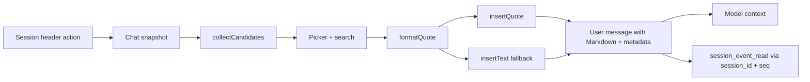

# dsh-better-quotes

[](https://github.com/SpellingDragon/dsh-better-quotes/actions/workflows/ci.yml)
[](LICENSE)

DeepSeek Harness Web 的多选消息引用插件：整条选择用户或助手消息，并带上模型可读、可回查的持久元数据。

多数 DSH 引用插件处理的是「选中的一段文字」。**dsh-better-quotes** 选择的是整条消息，支持用户与助手的任意组合，并在引用末尾保留发送人、时间、消息身份、模型路由、Skill、会话引用和附件清单。

```markdown
> The deployment failed after the schema change.
>
> [attachment kind=file name="deploy.log" bytes=4096 id="…"]
>
> [multiquote role=assistant speaker=assistant provider="deepseek" model="deepseek-chat" time=2026-10-26T04:05:06.789Z seq=42 message_id="…" session_id="…"]
```

## 功能

- **整条消息自由多选**：用户消息、插话消息、已定稿助手消息可任意组合，不只支持划选一段文字。
- **面板内搜索**：按正文、角色、provider/model、Skill、会话引用或附件名过滤。
- **持久元数据**：`session_id`、`seq`、`message_id`、`role`、`speaker`、ISO 时间、provider/model、Skill 和引用来源。
- **多模态感知**：图片和文件转为 `[attachment …]` 清单，记录持久 id、名称、大小、媒体类型和尺寸；不复制字节和像素。
- **模型回查路径**：额外挂载 `dsh-tool-session-query` 后，模型可用 `session_id` 与 `seq` 调 `session_event_read`。
- **定位原消息**：跳回已渲染的原消息并短暂高亮。
- **只用公开扩展点**：通过标准 Session props 读取 Chat 快照，不做 DOM 注入，不横向导入其他插件。
- **原子引用与兼容回退**：宿主提供 `insertQuote` 时使用原子引用；旧宿主回退到光标处 `insertText`。
- **生命周期安全**：头部入口、语言字典和注入样式都随插件 fiber 一起移除。
- **纯本地**：无网络请求、无遥测、无外部服务。

## 快速开始

### 构建可安装的 tarball

```sh
npm ci
npm run build
npm pack
```

生成 `dsh-better-quotes-0.1.0.tgz`。`npm pack` 会通过 `prepack` 自动构建。

### 安装到 DeepSeek Harness

```sh
dsh plugin --profile web add /absolute/path/to/dsh-better-quotes-0.1.0.tgz
```

如果从源码仓库运行 DSH：

```sh
pnpm dsh plugin --profile web add /absolute/path/to/dsh-better-quotes-0.1.0.tgz
```

重启 `dsh web` 或刷新页面，Session 头部会出现 **多选引用**。

### 从 npm registry 安装

包已配置为 `npm publish --access public`。发布后安装命令为：

```sh
dsh plugin --profile web add dsh-better-quotes
```

## 使用

1. 打开 Session，点击头部 **多选引用**。
2. 搜索或滚动，勾选任意用户或助手消息。
3. 使用 **全选** / **清空** 批量操作当前过滤后的列表。
4. 点击 **插入引用**。消息按原始日志顺序进入输入框；宿主支持时每条都是独立原子引用。
5. 点击行内定位按钮可滚动回原消息。

Chat 视图未激活时头部入口不可用。面板只列出当前可见、已定稿的 Chat 节点；折叠的过程行和运行中的助手消息不会出现。

## 元数据

每条引用末尾有一行机器可读元数据：

```text
[multiquote role=… speaker=… provider=… model=… time=… seq=… message_id=… session_id=… skills=[…] references=[…]]
```

| 字段 | 含义 |
|---|---|
| `role` | `user` 或 `assistant` |
| `speaker` | 发送人标签；当前与 `role` 一致 |
| `mode=steering` | 用户消息在回合进行中插入时出现 |
| `provider` / `model` | 助手消息的模型路由，来自 `providerMetadata` |
| `time` | 原始事件 envelope 的 ISO 8601 时间 |
| `seq` | 原始事件序号，供 `session_event_read` 使用 |
| `message_id` | 持久消息身份；宿主不提供时省略 |
| `session_id` | 原事件所属 Session |
| `skills` | 该用户消息加载的 Skill 名称 |
| `references` | 该消息附带的 `@session` 引用标签 |

附件单独一行，避免复制字节：

```text
[attachment kind=image name="chart.png" media_type="image/png" bytes=245760 width=1280 height=720 id="…"]
[attachment kind=file name="deploy.log" bytes=4096 id="…"]
```

## 多模态行为

- 用户消息贡献正文、图片、文件、Skill 和会话引用。
- 助手消息贡献正文、图片以及 provider/model 路由。
- 推理和工具调用不进入引用。
- 附件只被引用、不被重新上传；原消息仍是唯一事实来源。若历史压缩移除了原消息，图片像素可能不可用；文件也只有在原始保存路径仍存在时可读。
- 重新附加原始附件是后续计划。

## 模型回查

引用带有 `session_id` 与 `seq`。挂载实验性的 session query 工具：

```yaml
- name: '@deepseek-ai/dsh-tool-session-query'
```

模型即可用引用里的身份调用 `session_event_read`。未挂载时，引用正文和元数据仍可读，但不能按身份查询原事件。

## 兼容性

| 宿主行为 | 插件行为 |
|---|---|
| DSH `>=0.2.1-rc.3 <0.3.0-0` | 支持的目标版本 |
| 存在 `InputActions.insertQuote` | 输入框内生成原子引用节点 |
| 不存在 `insertQuote` | 通过 `insertText` 在光标处插入 Markdown 引用 |
| 用户消息带 `messageId` | 输出 `message_id` |
| 用户消息没有 `messageId` | 引用仍可用，省略 `message_id` |
| Chat 视图未激活 | 头部入口禁用 |

包本身没有运行时 npm 依赖。浏览器 bundle 从 DSH 模块表请求 React、`react/jsx-runtime` 和 `@deepseek-ai/dsh-client-ui-primitives`。

## 隐私与安全

- 不发起外部 HTTP 请求，不接遥测或远程服务。
- 不做 DOM 抓取：候选消息来自 DSH 已渲染的 Chat 快照。
- 附件字节、图片像素和本地文件路径不会复制进引用。
- 引用文本就是普通用户消息内容，会像其他 prompt 一样进入 Session 日志。
- React 会转义所有渲染文本；插件不注入 HTML。
- CSS 类名统一加 `bq-` 前缀，降低冲突概率。

## 与热门插件对比

DSH 插件生态变化很快。下表基于 **2026-10-26** 的公开 README，具体行为请以各上游仓库为准。

| 插件 | 选择粒度 | 每条消息的持久元数据 | 多模态信息 | 入口 |
|---|---|---|---|---|
| **dsh-better-quotes** | 用户/助手整条消息，任意组合 | `session_id`、`seq`、`message_id`、时间、角色、路由、Skill、引用 | 图片/文件清单 | 头部对话框 + 搜索 |
| [dsh-message-forward](https://github.com/Domaki-co/dsh-message-forward) | 单条或多选整条消息 | 来源会话与说话者，面向转发 | 文本和图片 | 长按多选、转发弹窗 |
| [dsh-quote-followup](https://github.com/tr1v3r/dsh-quote-followup) | 选中文本片段 | 以文本选择为主，面向追问 | 文本 | 划词工具条 / chip |
| [dsh-select-quote](https://github.com/latte03/dsh-select-quote) | 选中文本 | 以文本选择为主，支持堆叠卡片 | 文本 | 浮动划词工具条 |
| [dsh-quote-annotate-pro](https://github.com/zhao-guang-ai/dsh-quote-annotate-pro) | 选中文本并批注 | 轮次/角色锚点与紧凑引用块 | 文本 | 划词工具条 |
| [dsh-multi-selection-comments](https://github.com/yuanc1204/dsh-multi-selection-comments) | 多个独立文本片段 | 结构化上下文注入 | 文本 | 划词工具条 |

从这些插件借鉴的点：

- **dsh-message-forward**：把整条消息多选作为一等流程，并明确写出兼容性、安全边界和限制。
- **dsh-quote-annotate-pro**：紧凑的引用呈现和来源锚点。
- **dsh-select-quote**：多条引用可独立删除，发送时剥离标记。
- **dsh-multi-selection-comments**：用结构化上下文注入，而不是随手拼接文本。
- **dsh-quote-followup**：只用公开扩展点，并明确 Web-only 范围。

有意不同的取舍：

- **面板而不是内联复选框**：当前 DSH 没有官方用户消息动作槽位；基于 Chat 快照的头部对话框避免维护 DOM 注入契约。
- **消息级而不是文本级**：引用保留整条消息和附件；用户仍可通过选择消息而非选段来缩小范围。
- **元数据尾巴而不是隐藏状态**：引用是纯 Markdown，复制、重发和日志回放都不会丢失；不依赖浏览器侧伴随存储。

## 设计说明

- **不做 DOM 抓取**：`collectCandidates` 只读取 Chat 快照中可见的 `user`、`steering`、`assistant-step` 节点；定位时才使用已渲染的 `data-chat-node-key` 做滚动。
- **元数据放在末尾**：正文在前，官方引用预览先显示有意义的内容；身份信息集中在末尾一行。
- **一条消息一个引用**：选择顺序会归一化为日志顺序，每条仍可独立删除。
- **附件清单而不是副本**：持久附件 id 指回原消息；插件从不读取文件字节或图片像素。
- **兼容回退**：当前源码宿主提供 `insertQuote`；旧宿主保留 `insertText` + `captureInsertion`，不会硬依赖新输入 API。
- **过滤后全选**：**全选** 只选择当前过滤结果，不包含被隐藏的行。



## 限制与后续计划

- 选择入口是头部对话框，不向消息行注入内联复选框。
- 已发送引用的预览使用官方引用呈现；从已发送引用点击跳回尚未实现（面板内可定位）。
- 附件只引用、不重新附加；重新附加图片/文件与缩略图在计划中。
- 只列出当前已加载、可见的 Chat 窗口；超长历史受 DSH 已加载窗口限制。
- 模型回查依赖可选的 `dsh-tool-session-query` bundle。
- 暂无浏览器 E2E 或 GIF；现有测试覆盖候选投影、格式化、面板交互、回退插入和注册生命周期。

## 开发

```sh
npm ci
npm run typecheck
npm test
npm run build
npm pack
```

- `src/client/candidates.ts` — Chat 快照到引用候选项。
- `src/client/format.ts` — Markdown 与元数据序列化。
- `src/client/MessageMultiquote.tsx` — 面板、搜索、选择、定位。
- `src/client/styles.ts` — 带 disposer 的插件样式。
- `tests/` — 23 个聚焦测试，覆盖格式化、投影、面板行为、回退插入和生命周期。

## 许可证

MIT。见 [LICENSE](LICENSE)。

English documentation: [README.md](README.md)。
